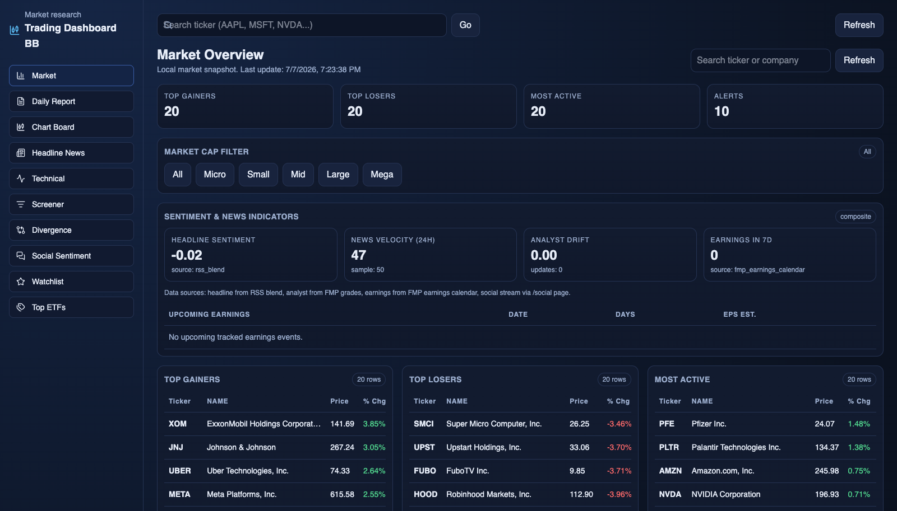
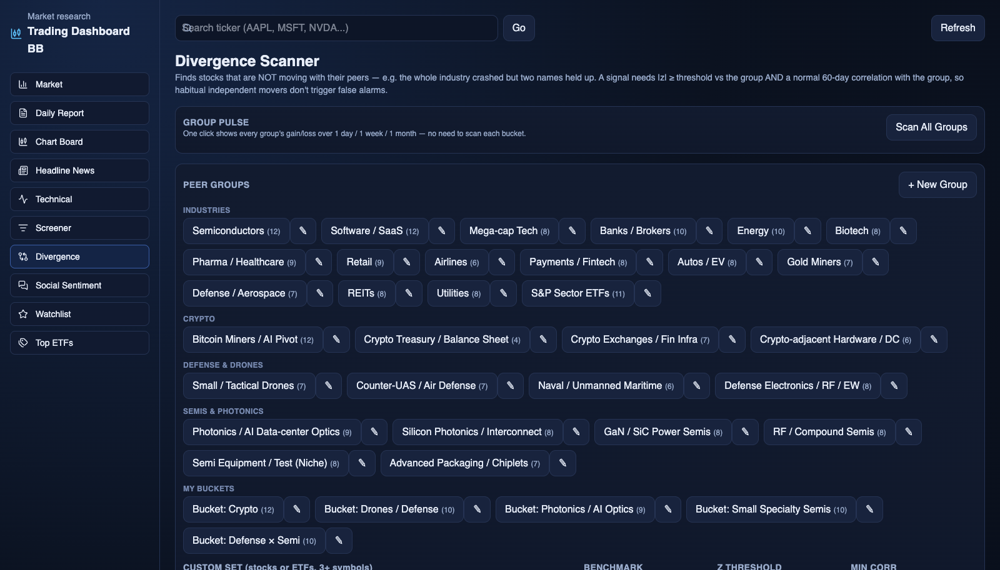

# Trading Dashboard (OpenBB-backed)

[](https://github.com/eatusc-personal/trading-bb/actions/workflows/ci.yml)

A local, full-stack market-research dashboard: real-time quotes and technicals,
a **peer-divergence scanner** (leave-one-out z-scores that flag stocks *not*
moving with their group), a **Reddit/Stocktwits social-sentiment signal-lab**
with tiered scoring and event studies, screeners, ETF holdings, and consolidated
news, one Next.js app over a Python FastAPI backend with multi-provider market
data, per-provider budget guards, and stale-while-revalidate caching.

**Stack:** Next.js 16 (App Router, TypeScript, Tailwind) · Python FastAPI ·
OpenBB + provider routing (TwelveData / FMP / Marketstack) · SQLite.



## Quickstart

```bash
git clone https://github.com/eatusc-personal/trading-bb && cd trading-bb
python3 -m venv .venv && .venv/bin/pip install -r python_api/requirements.txt
cp .env.example .env       # add at least one market-data provider key
npm install
npm run dev                # Next on :3000, Python API on :8001
```

The Next frontend proxies every `/api/*` call to the FastAPI process on
`127.0.0.1:8001`, so the browser only ever talks to one origin.

## Engineering highlights

- **Peer-divergence scanner**: flags stocks that are *not* moving with their
  group using a robust leave-one-out z-score (median/MAD) over 1D/5D/20D
  windows, gated by a 60-day correlation and beta check vs an equal-weight
  peer index so habitual independent movers don't false-trigger.
  (`python_api/divergence.py`, details below)
- **Resilient market-data layer**: a multi-provider router
  (TwelveData, FMP, Marketstack, yfinance) with automatic failover,
  per-provider budget guards (per-minute/day, SQLite-persisted), and
  cooldown/backoff on quota or auth failures.
- **Stale-while-revalidate everywhere**: slow endpoints answer instantly from
  the last completed result and refresh in a single-flight background
  thread; results persist in SQLite so restarts never cold-start (warm
  responses 20-200ms).
- **Social-sentiment signal-lab**: multi-source ingestion (Reddit, Stocktwits,
  Apewisdom) with ticker extraction, tiered candidate scoring, tradability /
  liquidity gates, and horizon-based event-study backtesting of signals.
- **Confluence-ranked daily report**: cross-tab synthesis (movers, technical
  flags, social buzz, peer divergence, headlines, ETFs) ranked by how many
  independent signals agree.
- **Hardening**: symbol regex + request size caps, per-IP rate limiting,
  optional API-key auth, and localhost-scoped CORS.

## How the divergence scanner works

The interesting event in a peer group is usually not the group move itself,
it is the one member that ignored it. For every scanned set (a curated peer
group or a custom list) and every window `w` in {1, 5, 20} trading days:

1. Compute each member's percent return over the window.
2. Score each member against its peers with a **leave-one-out robust
   z-score**: the member is removed, and the remaining peers' median and MAD
   (median absolute deviation) form the center and scale. That way one big
   outlier cannot hide itself by dragging the group mean and variance along
   with it.

   ```
   z_i = (r_i - median(r_peers)) / (1.4826 * MAD(r_peers))
   ```

   The 1.4826 factor is the usual consistency constant that makes MAD
   comparable to a standard deviation under normality. If the peers are
   nearly identical (MAD ~ 0) the scale falls back to their standard
   deviation, and z is clamped to +/-15 so degenerate windows cannot produce
   absurd scores.
3. Decide whether the group actually moved: the flat threshold scales with
   the window as `0.5 * sqrt(w)` percent, and the sign of the group move plus
   the sign of z picks a plain-English label ("Held up while group fell",
   "Lagged group rally", "Moved independently of flat group", ...).
4. **Gate on 60-day co-movement**: each member's daily returns are correlated
   (and beta-fit) against the equal-weight mean of the *other* members. A
   signal is only confirmed as a diverger when `|z| >= 2.0` (configurable)
   **and** the 60-day correlation is at least 0.30. Low-correlation names
   still appear with their z-scores but are marked `low_correlation` instead
   of flagged: a divergence is only interesting when the name normally tracks
   the group.



Peer groups (35 seeded, across industries, crypto, defense, and photonics)
live in an editable `python_api/peer_groups.json` and can be managed from the
UI or the CRUD API under `/api/divergence/groups`.

## Background

This began as an OpenBB-based dashboard and was re-architected from there. The
market-data layer was replaced with a custom multi-provider router (direct
TwelveData/FMP/Marketstack calls with automatic failover and per-provider budget
guards) and the peer-divergence scanner, social-sentiment signal-lab, and
stale-while-revalidate caching were built on top. OpenBB is retained as one
fallback source (discovery + yfinance). The Python backend is split into focused
modules (`providers`, `news`, `social`, `symbol_master`, `db`, `net`, `config`,
`indicators`, `utils`, `cache`) with a pytest suite.

## Configuration

`.env.example` is the starting template; the API auto-loads `.env` /
`.env.local` from the repo root or `python_api/`. Provider keys, router
priorities, budget overrides, cache TTLs, social-ingestion pacing, and the
optional security hardening knobs (API key, rate limits, CORS) are all
environment variables; see [docs/CONFIGURATION.md](docs/CONFIGURATION.md) for
the full reference, the data-storage map, and the smoke-test runbook.

## Tests

```bash
.venv/bin/pip install -r requirements-dev.txt
.venv/bin/python -m pytest
```

`tests/` covers the pure indicator math (SMA/RSI/MACD/RVOL + trigger flags),
the divergence scanner math (robust z-score, window returns, correlation
gating, labels), social scoring helpers, the per-provider budget guard, and
endpoint smoke tests via FastAPI's `TestClient`, all offline, no market-data
calls. CI runs pytest, ruff, and a full frontend type-check + build.

## More documentation

- [docs/FEATURES.md](docs/FEATURES.md): the full per-page feature list and
  backend endpoint inventory.
- [docs/PROGRESS.md](docs/PROGRESS.md): engineering journal (dated notes on
  what changed and why, with measurements).
- [TRADING_DASH.md](TRADING_DASH.md): technical + functional specification.
- [docs/CONFIGURATION.md](docs/CONFIGURATION.md): environment variables,
  provider budgets, persistence/deployment notes.

## License

This project's own code is licensed **MIT**, see [LICENSE](LICENSE).

It depends on [OpenBB](https://github.com/OpenBB-finance/OpenBB) (installed via
pip, not vendored here), which is licensed **AGPL-3.0**. Market data is subject
to each provider's terms (TwelveData, FMP, Marketstack, etc.). This is an
educational/research tool, not financial advice.
